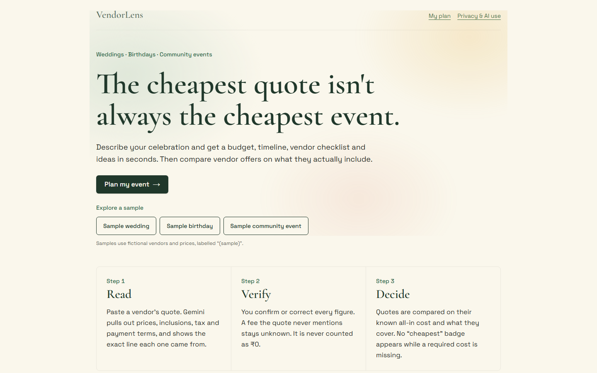
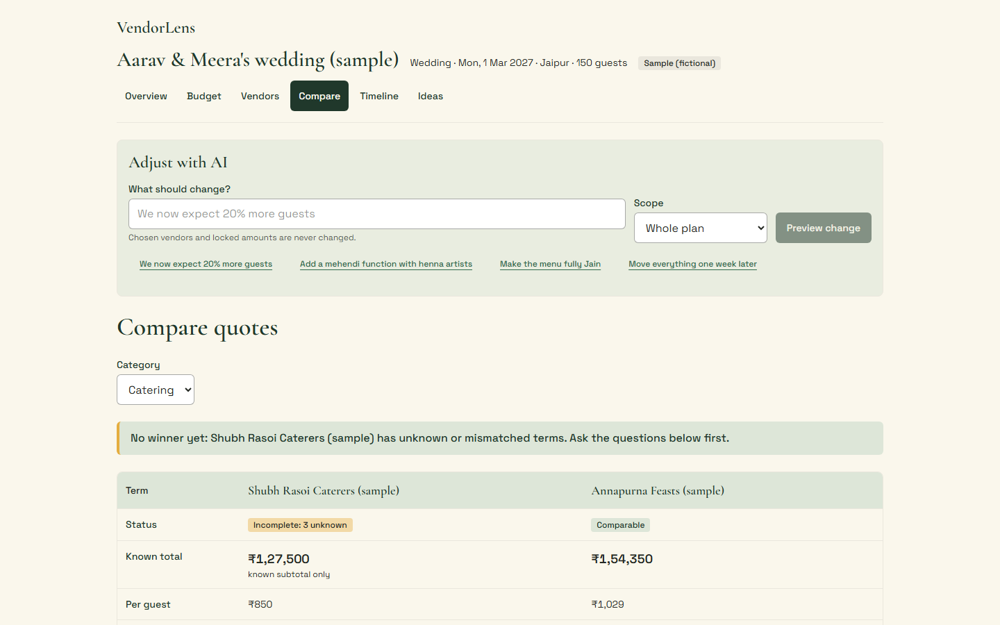
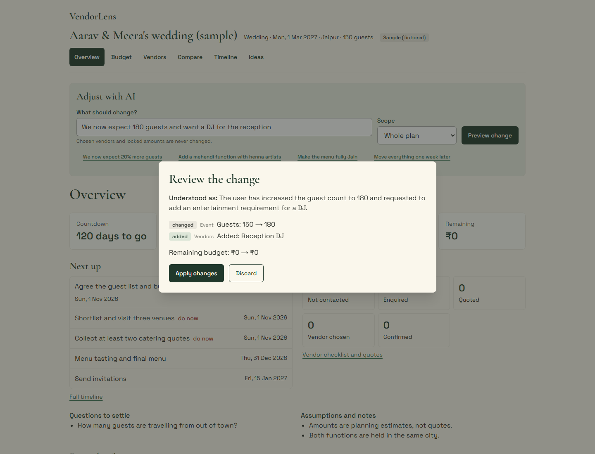
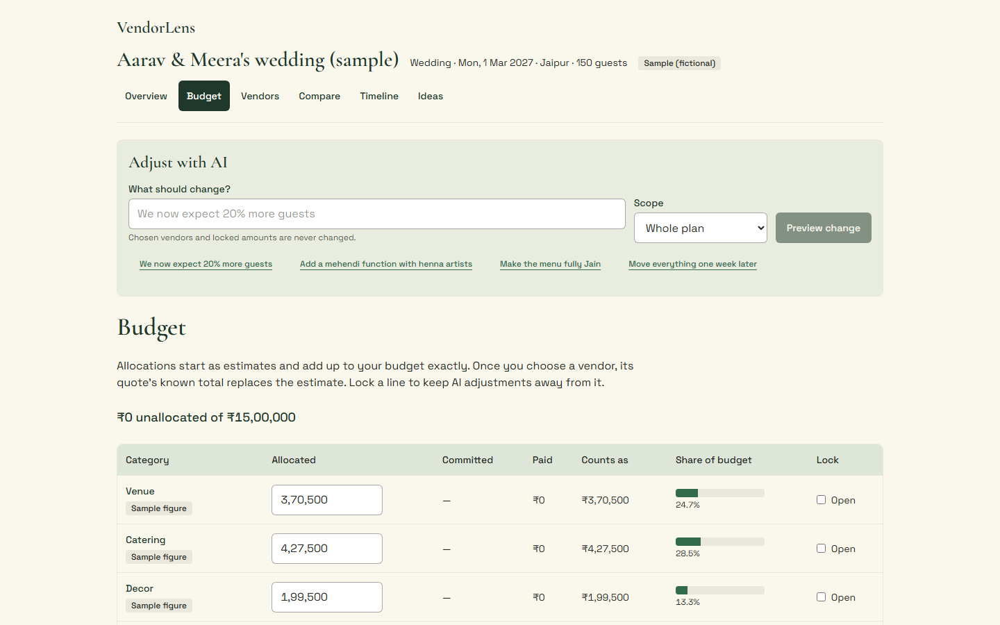
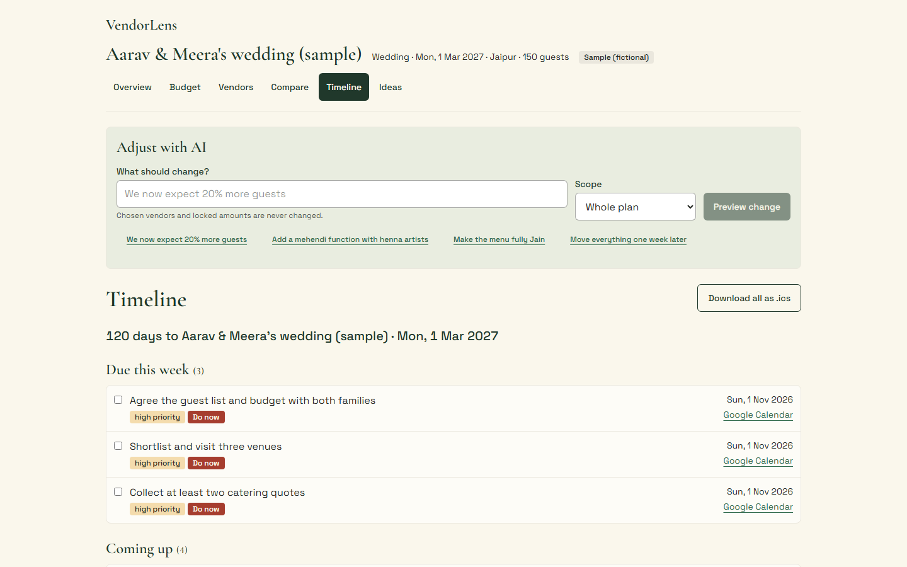

<div align="center">

#  &nbsp;VendorLens

### Know what you're paying for

**The cheapest quote isn't always the cheapest event.**

**Because a caterer's ₹850 a plate means nothing until you know the tax, the staff and the transport it leaves out.**

VendorLens plans **weddings, birthdays and community events** and then helps you choose vendors honestly. Gemini drafts the budget, timeline, vendor checklist, ideas and run sheet, and reads the quotes vendors send you, pointing at the exact words each figure came from. You confirm what it found. Tested TypeScript then compares quotes on their real, known cost, and refuses to call anything "cheapest" while a required cost is still unknown.


Built for **PromptWars Virtual Challenge 5**
Problem statement: _Celebration & Event Planner_

**[Live demo → vendorlens-promptwars.web.app](https://vendorlens-promptwars.web.app)**

<br />



</div>

| Production                                                            |                                 Event kinds |           Automated verification |                         Accessibility |
| --------------------------------------------------------------------- | ------------------------------------------: | -------------------------------: | ------------------------------------: |
| [Firebase Hosting → Cloud Run](https://vendorlens-promptwars.web.app) | **Weddings · birthdays · community events** | **123 unit + 40 browser checks** | **0 serious axe findings · 8 routes** |

**Deeper documents:** [Architecture](docs/ARCHITECTURE.md) · [Security](docs/SECURITY.md) · [Testing](docs/TESTING.md) · [Accessibility](docs/ACCESSIBILITY.md) · [Prompt changelog](docs/prompts-changelog.md) · [ADRs](docs/adr)

**60-second judge path:** press **Sample wedding**. It opens on **Compare**, where the cheaper-looking caterer gets **"No winner yet"** because three of its costs are unknown. Choose the complete quote, watch its payment terms become dated tasks on **Timeline**, then try **Adjust with AI**.

---

##  &nbsp;What VendorLens is

Most celebration budgets go wrong at the same moment: when the quotes arrive. One caterer quotes per plate, another per head with service staff extra, a third includes GST and the fourth doesn't mention it. The lowest number on the page is rarely the lowest bill.

VendorLens is built around that moment. It plans the whole event, but its centre is a **Read → Verify → Decide** loop for vendor quotes:

| Step       | Who does it    | What happens                                                                                                                         |
| ---------- | -------------- | ------------------------------------------------------------------------------------------------------------------------------------ |
| **Read**   | Gemini         | Pulls prices, inclusions, tax and payment terms out of a pasted quote, quoting the exact words for each                              |
| **Verify** | Code, then you | Code checks every quoted excerpt really is in the text and every number really is in its excerpt. You confirm or correct each figure |
| **Decide** | Code           | Quotes are compared on their known all-in cost and what they cover. A missing required cost is never counted as ₹0                   |

The rule that runs through all of it: **an unknown stays unknown.** A fee the quote never mentions is shown as a question to ask, not as zero.

---

##  &nbsp;The brief, met

**Challenge 5: build a GenAI assistant that turns a celebration idea into an actionable plan and helps refine it.**

| The brief asks for                | How VendorLens delivers it                                                                                                                                                                                            | Where                                                 |
| --------------------------------- | --------------------------------------------------------------------------------------------------------------------------------------------------------------------------------------------------------------------- | ----------------------------------------------------- |
| **Idea → actionable plan**        | Gemini drafts category weights, vendor needs with coverage tags and questions, tasks with lead times and dependencies, ideas and a run sheet. Code turns weights into exact rupees and lead times into IST dates      | `src/server/ai/tasks.ts` · `src/domain/plan-build.ts` |
| **Refine with follow-up prompts** | **Adjust with AI**: one instruction becomes typed operations, previewed as a before/after diff with budget impact, then applied or discarded. Ten steps of undo                                                       | `src/features/adjust/` · `src/domain/adjust.ts`       |
| **Budget**                        | The eight brief categories plus contingency. Allocated → committed (chosen quote) → paid, with remaining or over-budget. Every amount shows its source. Lock a line to keep AI away from it                           | `src/domain/budget.ts` · `src/features/budget/`       |
| **Timeline**                      | Overdue, due this week and later; priorities; "do now" when a date has passed; countdown; booking deadlines; payment milestones; run sheet; Google Calendar links and `.ics` download                                 | `src/domain/timeline.ts` · `src/domain/calendar.ts`   |
| **Vendor checklist**              | Needs per category with why, questions and book-by date; status from _not contacted_ to _booking confirmed_; contacts and notes in this browser only; Google Maps search links; quote intake by paste or manual entry | `src/features/vendors/`                               |
| **Personalised ideas**            | Ideas tied to the event type, guests, budget, culture and declared diets (checked in code), always with an accessibility and a sustainability idea; pin, remove or ask for more like these                            | `src/features/ideas/`                                 |
| **Compare vendors**               | Side-by-side quotes on known total, per-guest cost, inclusions, unknowns and payment terms, with the questions still to ask                                                                                           | `src/domain/compare.ts` · `src/features/compare/`     |
| **Saved, editable, recoverable**  | Autosaved to IndexedDB; versioned JSON backup and import; print stylesheet                                                                                                                                            | `src/lib/local-db/`                                   |

---

##  &nbsp;Feature overview

**Plan my event.** A short wizard for the kind of event, date, city, guests, budget, culture and dietary needs. Gemini drafts the plan; code builds the costed, dated version. With AI off or unavailable, a labelled template plan appears instead.

**Overview.** Countdown, budget and what's remaining, the next tasks, vendor progress from _not contacted_ to _confirmed_, and the open questions and assumptions behind the plan.

**Budget.** Every category shows allocated, committed and paid amounts. Each figure carries its source: _AI estimate_, _your figure_, _chosen quote_ or _sample_, so a guess is never mistaken for a commitment.

**Vendors and quote intake.** Paste a vendor's message or quote. Gemini extracts the lines, inclusions, tax and payment schedule with an excerpt for each. Anything it can't point to becomes _not found_. You review every field before the quote counts.

**Compare.** Quotes for one category side by side: status, known total, per guest, what's included, what's unknown and what to ask. A **lowest known total** is named only when every quote in the view is complete.

**Choosing a quote.** The chosen quote's known total becomes the category's committed amount, its vendor needs are marked decided, and its payment schedule (for example 50 / 30 / 20) becomes dated payment tasks on the timeline.

**Adjust with AI.** Plain-language changes such as _"We now expect 20% more guests"_ or _"Add a mehendi function with henna artists"_, previewed as a diff with the budget effect before anything is saved.

###  &nbsp;Screens

| Compare quotes                                                                                                                                   | Adjust with AI                                                                                                     |
| ------------------------------------------------------------------------------------------------------------------------------------------------ | ------------------------------------------------------------------------------------------------------------------ |
|  |  |
| **Budget**                                                                                                                                       | **Timeline**                                                                                                       |
|                                   |    |

---

##  &nbsp;What makes it different

| Capability                                     | What is behind it                                                                                                                                                                            |
| ---------------------------------------------- | -------------------------------------------------------------------------------------------------------------------------------------------------------------------------------------------- |
| **Unknown is never ₹0**                        | An unpriced mandatory line, an unknown required extra or an unknown tax makes a quote _incomplete_, and it can't win a comparison (`src/domain/quote-normalize.ts`)                          |
| **Every extracted figure has a receipt**       | The model must quote the words it read. Code checks the excerpt is in the pasted text **and** that the number appears in that excerpt (`src/domain/evidence.ts`, `src/domain/extraction.ts`) |
| **"Cheapest" has to be earned**                | A lowest known total is named only when there are two or more quotes and every one is comparable; otherwise the verdict says exactly what's in the way (`src/domain/compare.ts`)             |
| **Choices flow into the plan**                 | Choosing a quote commits its total and turns its payment terms into dated tasks, replacing any earlier choice exactly once (`src/domain/decision.ts`, `src/domain/payment-schedule.ts`)      |
| **The model never does arithmetic**            | Schemas have no totals, taxes or rankings. Budgets are allocated to the paisa with the largest-remainder method (`src/domain/allocation.ts`, `src/domain/money.ts`)                          |
| **Chosen vendors and locked amounts are safe** | Adjust drops operations on chosen vendors, locked amounts and required needs, and says why (`src/domain/adjust.ts`)                                                                          |
| **Private by construction**                    | Plans, quotes and contacts live in IndexedDB. Contact details are redacted before any prompt and links or contacts are scrubbed from answers (`src/server/ai/text-safety.ts`)                |

---

##  &nbsp;Where AI stops and code starts

| Call                   | Gemini does                                                                            | Code does                                                                                                                            |
| ---------------------- | -------------------------------------------------------------------------------------- | ------------------------------------------------------------------------------------------------------------------------------------ |
| `POST /api/ai/draft`   | Decides what the event needs and suggests ideas                                        | Allocates the budget to the paisa, schedules dates in IST in dependency order, enforces required categories and the diet rule        |
| `POST /api/ai/adjust`  | Interprets a change request into operations that refer to items by short refs (R1, T1) | Drops operations on chosen vendors or locked amounts, removals of required needs, and out-of-scope or invented refs, with reasons    |
| `POST /api/ai/extract` | Reads a quote into candidate fields, **quoting the exact words** for each              | Verifies every excerpt and every number against the pasted text; anything else becomes _not found_. Nothing counts until you confirm |

**Models:** `gemini-3.5-flash-lite` on Vertex AI, with `gemini-3.1-flash-lite` as the fallback; both are configurable. Prompts are versioned in `src/server/ai/prompts.ts` and recorded in the [prompt changelog](docs/prompts-changelog.md).

---

##  &nbsp;How it works

The life of one vendor quote, from paste to payment tasks.

```text
       "₹850 per plate for 150 guests, 50% advance, GST extra..."
                                   │
                                   ▼
        ╭──────────────────────────────────────────────────╮
        │  QUOTE INTAKE                  features/vendors  │
        │  paste text, or enter it by hand                 │
        ╰─────────────────────────┬────────────────────────╯
                                  ▼
        ╭──────────────────────────────────────────────────╮
        │  POST /api/ai/extract       Cloud Run · Next.js  │
        │  origin → rate limit → size → Zod → cache        │
        │  contact details redacted before the prompt      │
        ╰─────────────────────────┬────────────────────────╯
                                  ▼
        ╭──────────────────────────────────────────────────╮
        │  GEMINI ON VERTEX AI         keyless · schema    │
        │  candidate fields, each with its exact excerpt   │
        ╰─────────────────────────┬────────────────────────╯
                                  ▼
        ╭──────────────────────────────────────────────────╮
        │  EVIDENCE CHECK                 domain/evidence  │
        │  excerpt in the text?  number in the excerpt?    │
        │  no → "not found", the value stays unknown       │
        ╰─────────────────────────┬────────────────────────╯
                                  ▼
        ╭──────────────────────────────────────────────────╮
        │  YOU REVIEW                     QuoteReview.tsx  │
        │  confirm or correct every figure                 │
        ╰─────────────────────────┬────────────────────────╯
                                  ▼
        ╭──────────────────────────────────────────────────╮
        │  NORMALIZE                quote-normalize.ts     │
        │  known total · per guest · unknowns · mismatches │
        │  status: comparable · incomplete · mismatch      │
        ╰─────────────────────────┬────────────────────────╯
                                  │
               ╭──────────────────┴──────────────────╮
               ▼                                     ▼
  ╭───────────────────────────╮       ╭───────────────────────────╮
  │  COMPARE                  │       │  CHOOSE                   │
  │  lowest known total only  │  ───► │  committed amount         │
  │  when every quote is      │       │  payment milestones       │
  │  comparable               │       │  → dated timeline tasks   │
  ╰───────────────────────────╯       ╰───────────────────────────╯
```

Plans are drafted and adjusted through the same guarded pipeline: Zod on the request, Gemini with a JSON schema, Zod and business rules on the answer, one targeted repair, a fallback model, then a labelled template. `src/domain` is pure TypeScript with no React, Next.js, network or storage, enforced by lint. More in [docs/ARCHITECTURE.md](docs/ARCHITECTURE.md).

---

##  &nbsp;How quotes are compared

Each confirmed quote is normalised into one of three states (`src/domain/quote-normalize.ts`):

| Status         | Meaning                                                                       | Can it win?                                              |
| -------------- | ----------------------------------------------------------------------------- | -------------------------------------------------------- |
| **Comparable** | Every required cost is known and the terms match the event                    | Yes                                                      |
| **Incomplete** | A mandatory line is unpriced, or a required extra or the tax is unknown       | No, its total is shown as a _known subtotal_ only        |
| **Mismatch**   | The quote's terms don't match the event (for example a different guest count) | No, the mismatch is shown instead of being silently used |

The verdict follows directly:

| Situation                             | Verdict                                                                                   |
| ------------------------------------- | ----------------------------------------------------------------------------------------- |
| Fewer than two confirmed quotes       | _Add at least two confirmed quotes to compare._                                           |
| Any quote is incomplete or mismatched | _No winner yet: …has unknown or mismatched terms. Ask the questions below first._         |
| Every quote is comparable             | _…has the lowest known total, ₹X below the next offer, with every required item covered._ |

##  &nbsp;The evidence check

An extracted field is accepted only if both checks pass (`src/domain/evidence.ts`):

```text
   model says:  unit price = 850   excerpt = "₹850 per plate"
                                      │
              ┌───────────────────────┴───────────────────────┐
              ▼                                               ▼
   is the excerpt in the pasted text?          is 850 written in the excerpt?
              │                                               │
              └──────────── both yes ──► value kept, provenance "found"
                            any no   ──► value null, provenance "not_found"
```

A test pastes a quote containing an injected instruction and confirms the injected price is dropped as _not found_.

---

##  &nbsp;Security and privacy

| Control                   | Implementation                                                                                                                                                    |
| ------------------------- | ----------------------------------------------------------------------------------------------------------------------------------------------------------------- |
| **No API keys anywhere**  | Cloud Run runs as a dedicated service account holding only `roles/aiplatform.user`; Vertex AI is called keyless. The build account holds only `roles/run.builder` |
| **Same-origin AI routes** | Requests from other origins are refused before any work is done                                                                                                   |
| **Rate limits**           | 10 per minute and 60 per day per client, 600 per day overall                                                                                                      |
| **Validation**            | Body-size limits and Zod on every request and every model answer, then business rules                                                                             |
| **Headers**               | Nonce-based CSP, `frame-ancestors 'none'` and other security headers from `proxy.ts`                                                                              |
| **Personal data**         | Contact details redacted before any prompt; links and contacts scrubbed from answers; nothing stored on the server                                                |
| **Secret scanning**       | gitleaks over the full history in CI, plus repository and client-bundle scans                                                                                     |

Details in [docs/SECURITY.md](docs/SECURITY.md).

##  &nbsp;Efficiency

- Gemini runs **only** on explicit buttons; a browser test asserts zero AI calls while comparing and choosing.
- A response cache and in-flight de-duplication share identical requests for 30 minutes (a repeat draft took 0.46 s live).
- Every sum, tax, ranking and date is computed locally.
- Cloud Run scales to zero between uses.

---

##  &nbsp;Verification

| Gate                                      | Result                                                                                                              |
| ----------------------------------------- | ------------------------------------------------------------------------------------------------------------------- |
| Unit, property and contract tests         | **123 passing** (Vitest)                                                                                            |
| Coverage on `src/domain` and `src/server` | **98.5% lines · 89.9% branches**, enforced in CI                                                                    |
| Browser journeys                          | **40 passing** on a 1440 px desktop and a Pixel 5 (Playwright), 3 skipped where an input is keyboard- or mouse-only |
| Accessibility scan                        | **0 serious or critical** axe findings on all 8 routes at both sizes                                                |
| Static checks                             | Strict TypeScript, `strictTypeChecked` ESLint with zero warnings, knip, Prettier                                    |
| Secrets                                   | gitleaks over full history; repository and bundle scans clean                                                       |

```bash
npm run verify                         # lint, types, dead code, format, tests + coverage gates
npm run build && npm run e2e           # production build, then Playwright with axe
npm run secrets && npm run secrets:bundle
```

The test map is in [docs/TESTING.md](docs/TESTING.md).

##  &nbsp;Accessibility

- Keyboard skip link, visible focus and native dialogs with focus return.
- Labelled fields with error summaries.
- Status in text (_Comparable_, _Incomplete: 3 unknown_, _do now_), never colour alone.
- 44 px targets and measured palette contrast.
- `prefers-reduced-motion` switches every effect off.

Details in [docs/ACCESSIBILITY.md](docs/ACCESSIBILITY.md).

##  &nbsp;Design and motion

Forest, emerald, sage and saffron on ivory, set in Cormorant and a grotesk sans.

| Effect                                                                                         | Where                 |
| ---------------------------------------------------------------------------------------------- | --------------------- |
| **Light cursor:** a small forest dot with a pale sage ring that follows and grows over buttons | Mouse devices only    |
| **Magnetic buttons** that lean a few pixels toward the pointer                                 | Primary actions       |
| **Spotlight cards** with a soft saffron glow that follows the pointer                          | Landing steps         |
| **Headline words** that rise into place, and a slow colour aura behind the hero                | Landing               |
| **Scroll reveals** and page transitions                                                        | Landing and workspace |

---

##  &nbsp;Tech stack

| Layer          | Technology                                                                                         |
| -------------- | -------------------------------------------------------------------------------------------------- |
| **AI**         | **Gemini on Vertex AI** via `@google/genai`, JSON response schemas, a primary and a fallback model |
| **App**        | **Next.js 16** (App Router, standalone) · **React 19** · **TypeScript** strict                     |
| **Styling**    | **Tailwind CSS 4** with design tokens                                                              |
| **Validation** | **Zod 4**                                                                                          |
| **Storage**    | **IndexedDB**, versioned JSON backup and import                                                    |
| **Testing**    | **Vitest** with coverage gates · **Playwright** with **axe-core**                                  |
| **Quality**    | ESLint `strictTypeChecked` · knip · Prettier · gitleaks · GitHub Actions                           |
| **Hosting**    | **Cloud Run** (asia-south1) behind **Firebase Hosting**                                            |

##  &nbsp;Google services

| Service                                       | Used for                                                                                              |
| --------------------------------------------- | ----------------------------------------------------------------------------------------------------- |
| **Gemini on Vertex AI**                       | Plan drafts, adjustments and quote extraction with JSON response schemas                              |
| **Cloud Run**                                 | The Next.js server, as a least-privilege service account                                              |
| **Firebase Hosting**                          | Public front door, CDN and TLS, rewriting every request to Cloud Run                                  |
| **Cloud Build** and **Artifact Registry**     | Building and storing the container                                                                    |
| **Cloud Logging**                             | One JSON line per AI call: task, model, latency, tokens and failed rule ids, never user or model text |
| **Google Calendar** and **Google Maps** links | "Add to calendar" for every task and deadline; a Maps search for vendors nearby, with no keys         |

---

##  &nbsp;Setup and local development

Requires **Node.js 22.12+**.

```bash
git clone https://github.com/SrishtiRathi23/vendorlens.git
cd vendorlens
npm ci
npm run dev          # AI is off by default; samples, templates and manual quotes still work
```

To use Gemini locally, sign in with Application Default Credentials and set three variables (see [.env.example](.env.example)):

```bash
gcloud auth application-default login
```

```env
AI_ENABLED=true
GOOGLE_CLOUD_PROJECT=your-project-id
GEMINI_MODEL=gemini-3.5-flash-lite
```

Deployment steps are in [docs/ARCHITECTURE.md](docs/ARCHITECTURE.md#deploying).

##  &nbsp;Project structure

```text
vendorlens/
├── src/
│   ├── app/                         routes (Next.js App Router)
│   │   ├── page.tsx                 landing
│   │   ├── new/                     plan my event
│   │   ├── workspace/               overview · budget · vendors · compare · timeline · ideas
│   │   ├── privacy/                 privacy and AI use
│   │   └── api/
│   │       ├── ai/draft/            draft a plan
│   │       ├── ai/adjust/           change request → typed operations
│   │       ├── ai/extract/          quote text → fields with excerpts
│   │       └── health/              readiness
│   ├── domain/                      pure TypeScript, no framework
│   │   ├── extraction.ts            model output → quote, with provenance
│   │   ├── evidence.ts              excerpt and number checks
│   │   ├── quote-normalize.ts       known total, unknowns, status
│   │   ├── compare.ts               verdicts that never guess
│   │   ├── decision.ts              choose a quote
│   │   ├── payment-schedule.ts      milestones → dated tasks
│   │   ├── allocation.ts · money.ts paise and largest remainder
│   │   ├── adjust.ts · diff.ts      typed operations and previews
│   │   └── timeline.ts · calendar.ts
│   ├── features/                    one folder per screen
│   ├── server/
│   │   ├── ai/                      pipeline, prompts, tasks, cache, text safety
│   │   └── http/                    env, guards, rate limit, errors, logging
│   ├── lib/                         IndexedDB, backup, API client
│   ├── ui/                          controls, dialog, money, interactions
│   └── proxy.ts                     CSP nonce and security headers
├── tests/                           domain and server tests
├── e2e/                             Playwright journeys with axe
├── docs/                            architecture, security, testing, accessibility, ADRs
├── Dockerfile                       standalone Next.js image for Cloud Run
└── firebase.json                    Hosting rewrite to Cloud Run
```

##  &nbsp;API reference

| Method | Endpoint          | Description                                                      |
| ------ | ----------------- | ---------------------------------------------------------------- |
| `POST` | `/api/ai/draft`   | Event details → a drafted plan shape                             |
| `POST` | `/api/ai/adjust`  | Plan snapshot + change request → typed operations                |
| `POST` | `/api/ai/extract` | Quote text → candidate fields, each with its excerpt             |
| `GET`  | `/api/health`     | Readiness and whether AI is enabled; never exposes configuration |

---

##  &nbsp;Demo flow

1. **Sample.** Press **Sample wedding**. It opens on **Compare** with two fictional catering quotes for 150 guests.
2. **No winner yet.** Shubh Rasoi looks cheaper at ₹850 a plate, but its tax, service staff and transport are unknown. VendorLens shows a _known subtotal_ only, says **No winner yet** and lists the questions to send.
3. **Choose.** Pick **Annapurna Feasts**. Its known total, ₹1,54,350 (150 × ₹980 + 5% GST), becomes the committed catering amount, and its 50 / 30 / 20 payment terms appear as dated tasks on **Timeline**.
4. **Adjust.** In **Adjust with AI**, type _"We now expect 180 guests and want a DJ for the reception"_. Review the diff, apply it, then **Undo**.
5. **Your own.** Press **Plan my event**, then paste a real quote on **Vendors** (a sample quote is one click away).

##  &nbsp;Honest limits

- Plans live in one browser: no accounts, sync or shared editing. Export a backup to move one.
- Quotes are pasted as text; PDFs and photos aren't read yet.
- Rate limits and the cache are per instance. The service runs a single instance, so they hold here.
- Budget figures are estimates until a quote is confirmed. VendorLens never verifies vendors, checks availability, books or takes payments.
- Extraction is checked, but it can still miss a term. That's why every quote is reviewed before it counts.

##  &nbsp;Roadmap

- Read quotes from PDFs and photos, with the same excerpt checks.
- Send the open questions to a vendor straight from Compare.
- Shared plans for families and organising committees.
- Track deposits and refunds against each chosen quote.

---

<div align="center">

**Choose vendors on what they really cost.**

PromptWars Virtual Challenge 5 · Powered by Google Cloud and Gemini · [MIT License](LICENSE)

</div>
